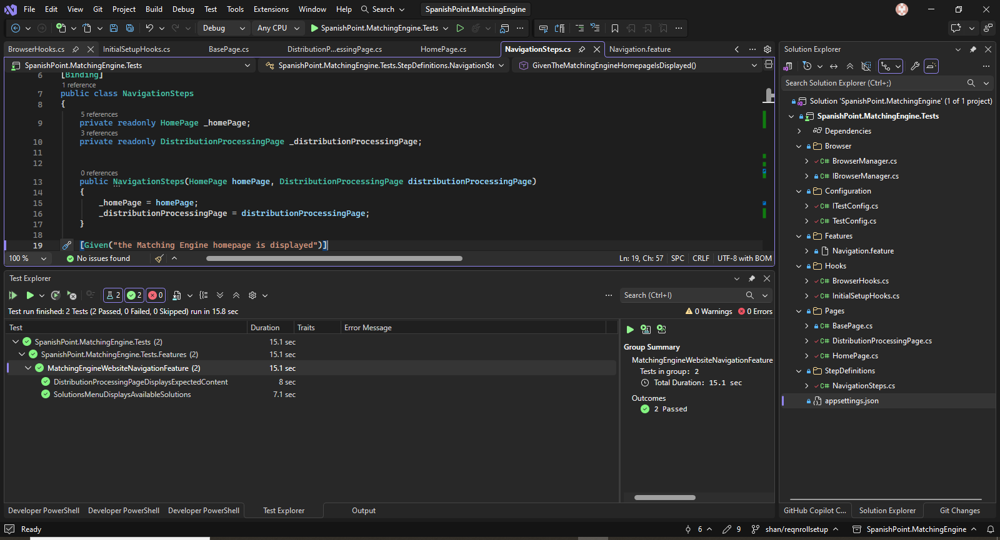

# Matching Engine UI Automation

UI automation tests for the Matching Engine website using C#, Selenium WebDriver, Reqnroll and NUnit.

I chose to use a Behaviour-Driven Development (BDD) approach, with test scenarios written in Gherkin and implemented using the Page Object Model (POM) design pattern.

## Test Scenarios

The project covers two automation scenarios:

1) **Solutions menu** – Verify that the "Solutions" dropdown displays the expected list of options.

2) **Distribution Processing** – Navigate to the Distribution Processing page and verify the content of the "All-in-one solution for scale" section.

Both scenarios are written in Gherkin and implemented using the Page Object Model.

## Tech Stack

- .NET 10 / C#

- Selenium WebDriver 4.51.0

- Reqnroll 3.3.4

- NUnit 4.3.2

- Google Chrome

- NuGet dependencies are managed through the .csproj file.

## Project Structure

Features – Gherkin scenarios

StepDefinitions – Step implementations

Pages – Page objects and element interactions

Hooks – Test setup and browser initialization

BrowserManager – WebDriver lifecycle management

Configuration – Test settings loaded from appsettings.json

## Running the Tests

**Prerequisites**: .NET 10 SDK and Google Chrome.

- Clone the repository.
     ```bash
   git clone https://github.com/PrajwalShanthigramaManjunath/SpanishPoint.MatchingEngine.git
   ```

- Open the solution in Visual Studio 2026 or navigate to the repository directory.
     ```bash
   cd SpanishPoint.MatchingEngine
   ```

- Restore dependencies:

   ```bash
   dotnet restore
   ```

- Run the tests:

   ```bash
   dotnet test
   ```

Tests can also be executed through Visual Studio Test Explorer.

## Notes

- Chrome is initialized separately for each scenario and closed after execution.

- Cookie banner is handled when it appears.

- Explicit waits are used for elements that may take time to load.

Test Results


